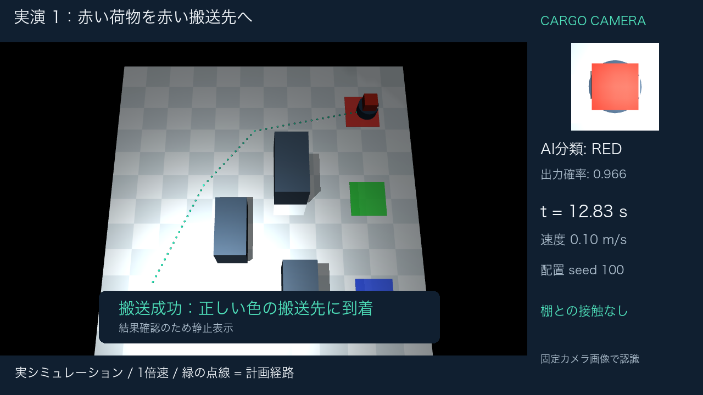

# AIで仕分け、滑らかに届ける

Physical AI 応用1 最終課題。**学習済み色分類MLP → 搬送先選択 → A* → 加速度を制限した速度制御**を接続した、MuJoCo上の搬送ロボットです。



## タスクとAIの役割

荷物を搭載した簡略化した全方向移動台車が、赤・緑・青の荷物を対応する搬送先に運びます。搭載カメラの中央20×20画素のRGB中央値を正規化し、**教師あり学習した3→16→3 MLP**へ入力します。認識結果が搬送先の選択に使われるため、AIは実際の行動に関与しています。物体の色の正解を制御へ直接渡していません。

MLPは、露光・ホワイトバランス・ノイズを変化させた合成RGBデータ6,000件で学習しました。学習済み重みを同梱し、外部API・有料サービス・ダウンロード済みの大規模モデル・GPUは不要です。3色という簡単な課題に限定しており、ルールベース分類に対する優位性は主張しません。

MuJoCoの2本のスライド関節と力アクチュエータで平面移動を実現します。位置は初期化時にのみ設定し、それ以降は`mj_step`の物理演算で進めます。荷物は固定され、把持と荷降ろしは対象外です。車輪接地・ヨー回転・差動二輪駆動の詳細モデルではありません。

## 実測結果

開発3配置の後に制御設定を固定し、別の30配置で3方式を評価しました。全90走行を保存しています。

| 方式 | 搬送成功 | 棚との接触 | 対応平均時間 | 平均ジャークRMS |
|---|---:|---:|---:|---:|
| 直進のみ（弱い参考方式） | 0/30 | 30/30 | 比較対象外 | 比較対象外 |
| A* | 30/30 | 0/30 | 11.020 s | 3.792 m/s³ |
| A* + 加速度制限 | 30/30 | 0/30 | 11.888 s | 0.766 m/s³ |

主要な比較はA*の2方式です。同じ30配置の成功走行において、提案方式は平均ジャークRMSを**79.8%低減**しました。時間は平均**0.868秒増加**し、経路長も5.902 mから6.038 mに増えました。ジャークは0.05秒間隔の実速度の2階差分から算出します。荷物の破損率を測ったものではありません。

独立な合成認識テスト1,500件で100%、評価時のMuJoCo画像30件で30/30件正解でした。合成認識テストは一般画像の認識性能を意味しません。灰色・暗い画像の拒否、通行不能時の経路なし判定などは別途9項目のテストで確認します。

**評価の限界：**同じ3本の棚構造内で、位置・照明・色・質量を摂動した評価です。未知の倉庫構造、動的障害物、実機への一般化は未検証です。30/30のWilson 95%区間は約88.6～100%（独立試行を仮定）で、一般環境での100%成功を保証しません。地図と自己位置は理想値で、物体検出やSLAMは含みません。

## 再現

Python 3.12 / macOS arm64で検証しました。以下はこのREADMEのあるフォルダで実行します。

```bash
python3.12 -m venv .venv
source .venv/bin/activate
python -m pip install -r requirements.txt
python -m unittest discover -s tests -v
python -m safe_delivery.simulation --split heldout
```

学習済みモデルは`models/color_mlp.npz`です。学習から再実行する場合は次のコマンドを使います。

```bash
python -m safe_delivery.perception
python -m safe_delivery.simulation --split dev
python -m safe_delivery.simulation --split heldout
```

結果は指定splitのフォルダに上書きされます。別の実験を行うときは、同梱結果を別の場所にコピーして保持してください。重みのNPZはZIP形式のタイムスタンプにより、同じ数値でも再学習時にファイルハッシュが変わり得ます。manifestは**評価実行時**の重みとソースを指します。

動画・レポートを再生成する場合：

```bash
python -m safe_delivery.media
python -m safe_delivery.report
python -m safe_delivery.verify
```

ZIPを再作成する場合は`python -m safe_delivery.package --destination ../deliverables`を実行します。提出一式と、動画・提出PDF・個人用提出手順書を除いたGitHub用ソースの2種類を作成します。動画とPDFは上記コマンドでローカルに再生成できます。`verify`は存在する動画・PDFを検証し、未生成のものは検証対象外と明記します。検証時の全依存バージョンは`requirements-lock-macos-arm64.txt`に保存しました。

レンダリングにはOpenGLが必要です。macOSで`invalid CoreGraphics connection`が出る場合は、画面アクセスが許されたローカルのターミナルで実行してください。LinuxではMuJoCo公式ドキュメントに従ってEGL/OSMesa等を準備する必要があり、本成果物でのLinux動作は未検証です。

動画はmacOSのヒラギノフォント、PDFはArial Unicode TrueTypeフォントを利用します。別環境では、利用とPDFへの埋込みが許された日本語フォントを用意し、`PAI_JAPANESE_FONT`（動画）、`PAI_PDF_FONT`（PDF）を指定してください。フォント本体は同梱していません。IDを設定する場合は`submission_settings.json`を変更し、動画・PDFを再生成します。

## ファイル

| 場所 | 内容 |
|---|---|
| `safe_delivery/perception.py` | 合成データ生成、MLPの学習・推論、受理判定 |
| `safe_delivery/planning.py` | 膨張地図、A*、経路短縮、指令変化の制限 |
| `safe_delivery/simulation.py` | シーン生成、MJCF、力制御、接触判定、比較実験 |
| `safe_delivery/media.py` | 実走行の再描画、字幕、実測値に基づく動画 |
| `safe_delivery/report.py` | 実測値に基づく提出PDF |
| `safe_delivery/verify.py` | 成果物の整合性確認 |
| `tests/test_system.py` | 9項目の認識・経路・物理動作テスト |
| `models/` | 学習済み重みと学習記録 |
| `results/dev/`, `results/heldout/` | 全走行記録、軌跡NPZ、条件・ソースハッシュ |
| `PROTOCOL.md` | 保留評価前に決めた評価条件 |
| `output/` | 実演画像、動画、レポート、検証結果 |

## 独自性と制作について

講座の課題サンプルを複製したものではなく、この課題向けに新規実装しました。競技での分布差と滑らかさに関する経験を、開発・評価の分離、複数指標の記録、同一条件での比較に反映しています。生成AI（Codex）を設計・実装・資料作成に使用しました。記載した性能は実際のローカル実行結果です。新規の学習アルゴリズムや最先端性能を主張するものではありません。

参照：[MuJoCo Python](https://mujoco.readthedocs.io/en/3.3.7/python.html)、[MJCF仕様](https://mujoco.readthedocs.io/en/3.3.7/XMLreference.html)。依存物は[THIRD_PARTY.md](THIRD_PARTY.md)を参照してください。
